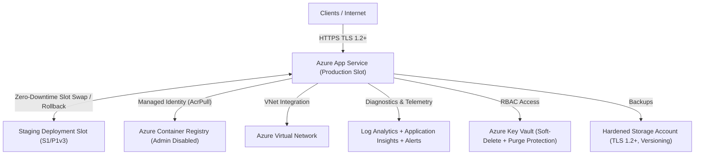
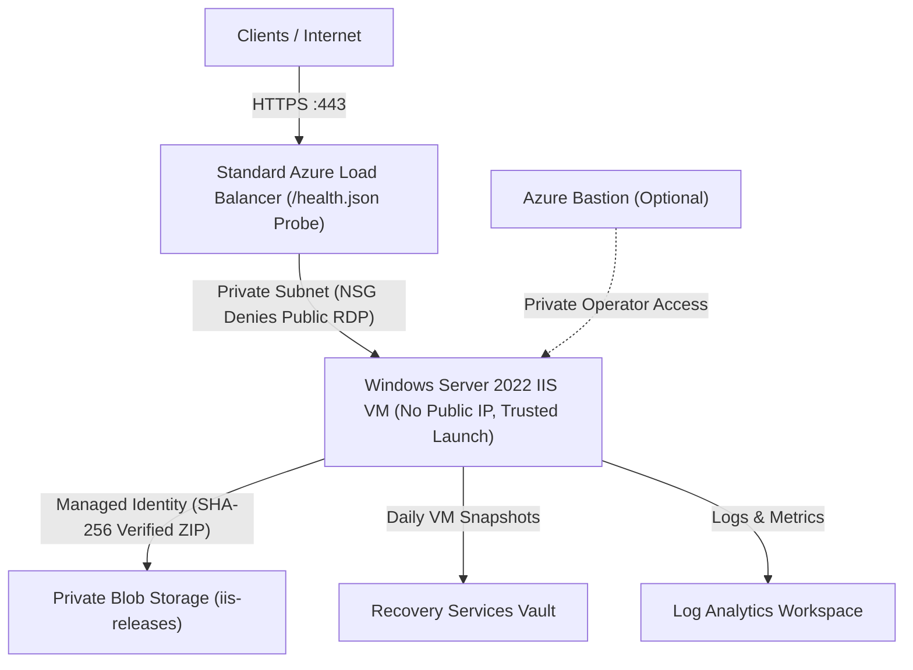
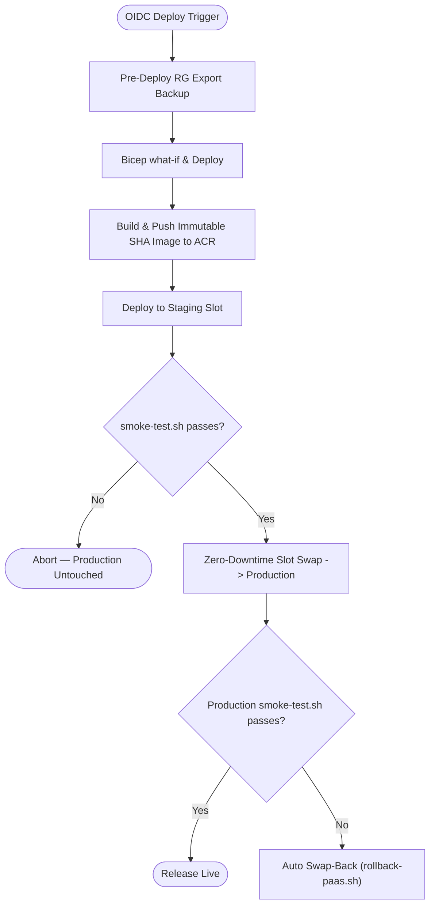

# azure-bicep-platform — Dual-Track Azure IaC Platform (PaaS + IaaS)

A production-grade, zero-ClickOps **Azure Infrastructure-as-Code (Bicep)** platform demonstrating both enterprise web publishing architectures on Azure:
- **Track A (PaaS — Recommended):** Linux Container **Azure App Service** with **Blue/Green Staging Deployment Slots**, VNet Integration, System-Assigned Managed Identity (`AcrPull`), private **Azure Container Registry**, **Key Vault (RBAC)**, **Log Analytics + Application Insights + Metric Alerts**, and 1-command slot swap-back rollback.
- **Track B (IaaS — Hardened IIS):** Private-subnet **Windows Server 2022 IIS VM** (zero public IP, zero public RDP, Trusted Launch Secure Boot + vTPM, Managed Identity) behind a **Standard Azure Load Balancer**, automated zero-RDP PowerShell provisioning & SHA-256-verified atomic release rollouts, **Azure Bastion**, and **Recovery Services Vault** backups.

---

## Architecture Diagrams

### Track A — Azure PaaS (App Service Blue/Green Slots)



### Track B — Azure IaaS (Hardened Windows Server IIS, Zero Public RDP)



---

## Track A (PaaS) vs Track B (IaaS) Comparison Matrix

| Dimension | Track A — Azure App Service (PaaS) | Track B — Windows Server IIS (IaaS) |
| --- | --- | --- |
| **Deployment Mechanism** | Immutable OCI container -> Staging Slot -> Smoke Test -> Zero-Downtime Swap | Deterministic static ZIP + SHA-256 -> Private Blob -> `az vm run-command` -> Atomic IIS path switch |
| **OS & Runtime Patching** | Managed by Azure + pinned non-root `nginxinc/nginx-unprivileged:1.27.4-alpine` | Automated Windows Updates + idempotent `configure-iis.ps1` |
| **Rollback Speed** | **Instant (~10s)** via `scripts/rollback-paas.sh` (slot swap-back) | **Instant (~5s)** via `infra/iaas/scripts/rollback-iis.ps1` (atomic IIS folder flip) |
| **Network Exposure** | HTTPS-only, TLS 1.2+, FTPS disabled, VNet Integration | Zero public IP on VM, NSG blocks public RDP 3389, Standard LB + optional Azure Bastion |
| **Est. Monthly Cost (`dev` / `prod`)** | ~\$13/mo (`B1`) / ~\$115/mo (`P1v3` + ACR + Logs) | ~\$75/mo (`B2ms` + LB) / ~\$240/mo (+ Bastion + RSV Backup) |

---

## Blue/Green PaaS Slot Swap & Rollback Flowchart



---

## Quick Start — Local Preview & Verification (Zero Azure Account Required)

```bash
git clone https://github.com/Mahmoud6601/azure-bicep-platform.git
cd azure-bicep-platform

cp .env.example .env
./scripts/generate-ssl.sh localhost
docker compose up -d --build

# Verify HTTPS, /healthz, /version.json, security headers, and 404 handling
./scripts/smoke-test.sh https://localhost local
```

Open **https://localhost** to view the live deployment verification payload (`/healthz`, `/version.json`, strict CSP/HSTS headers).

---

## Azure Deployment Guides

### Track A — PaaS (App Service + Blue/Green Slots)
```bash
az group create --name rg-azweb-staging --location eastus

# Preview changes with Bicep what-if
az deployment group what-if \
  --resource-group rg-azweb-staging \
  --template-file infra/bicep/main.bicep \
  --parameters infra/bicep/parameters/staging.bicepparam

# Deploy infrastructure + run blue/green rollout
az deployment group create \
  --resource-group rg-azweb-staging \
  --template-file infra/bicep/main.bicep \
  --parameters infra/bicep/parameters/staging.bicepparam
```
Or run `.github/workflows/deploy-paas.yml` with GitHub Actions OIDC (zero publish profiles or static client secrets).

### Track B — IaaS (Hardened Windows Server IIS, Zero RDP)
```bash
# Build deterministic static IIS ZIP + SHA-256 checksum
./scripts/package-iis.sh v1.0.0 "$(git rev-parse --short=7 HEAD)" staging
```
Provision via `.github/workflows/deploy-iaas.yml` or follow [`docs/DEPLOY-IAAS.md`](docs/DEPLOY-IAAS.md).

---

## Testing & Compliance

```bash
# 1. Payload hygiene, web.config XML & zero-PII verification
./tests/payload/verify-payload.sh

# 2. Bicep lint & compile across all environments (requires Azure CLI)
az bicep lint --file infra/bicep/main.bicep
az bicep build --file infra/bicep/main.bicep --outfile /tmp/main.json

# 3. PowerShell IIS script Pester unit tests (cross-platform via pwsh)
pwsh -Command "Invoke-Pester -Path tests/iaas/iis-scripts.Tests.ps1 -CI"
```

---

## Backup, Restore & Rollback

```bash
# Export checksummed Resource Group template backup
./scripts/backup-azure.sh rg-azweb-prod

# Verify & restore backup (interactive confirmation guard)
./scripts/restore-azure.sh rg-azweb-prod backups/rg-azweb-prod/rg-export-YYYYMMDD-HHMMSSZ.json.gz

# Track A (PaaS): Instant slot swap-back rollback
./scripts/rollback-paas.sh rg-azweb-prod <webapp-name>

# Track B (IaaS): Instant atomic IIS path rollback (via az vm run-command / Bastion)
# .\infra\iaas\scripts\rollback-iis.ps1
```

---

## Teardown (Cost Control)

```bash
az group delete --name rg-azweb-dev --yes --no-wait
```

---

## Troubleshooting

| Symptom | Likely Cause | Fix |
| --- | --- | --- |
| Staging slot not created in `dev` | `B1` Basic App Service Plan does not support deployment slots | Expected in `dev` (`supportsSlots = appServiceSku != 'B1'`); use `staging` (`S1`) or `prod` (`P1v3`) for slot swaps |
| `deploy-iis-release.ps1` aborts immediately | SHA-256 checksum mismatch between downloaded ZIP and expected hash | Re-run `./scripts/package-iis.sh` and upload matching ZIP + `.sha256` |
| OIDC workflow fails on login | Missing `AZURE_CLIENT_ID` / `AZURE_TENANT_ID` / `AZURE_SUBSCRIPTION_ID` vars | Configure Federated Identity Credential on your Entra ID App Registration (see `docs/DEPLOY-PAAS.md`) |

---

## Repository Structure

```text
.
├── .github/workflows/          # ci.yml, deploy-paas.yml (OIDC Blue/Green), deploy-iaas.yml (OIDC Zero-RDP)
├── infra/
│   ├── bicep/                  # bicepconfig.json, main.bicep, modules/*.bicep, parameters/{dev,staging,prod}.bicepparam
│   └── iaas/scripts/           # configure-iis.ps1, deploy-iis-release.ps1, rollback-iis.ps1
├── site/                       # Minimal verification payload (public/, iis/web.config, nginx/default.conf, Dockerfile)
├── nginx/                      # Local TLS reverse proxy for Docker Compose preview
├── scripts/                    # generate-ssl, package-iis, deploy-paas, rollback-paas, backup/restore-azure, smoke-test
├── tests/                      # payload/verify-payload.sh & iaas/iis-scripts.Tests.ps1 (Pester)
├── docs/                       # ARCHITECTURE.md, DEPLOY-PAAS.md, DEPLOY-IAAS.md, SECURITY.md, RUNBOOK.md
├── ps-rule.yaml                # PSRule for Azure Well-Architected compliance baseline
└── LICENSE                     # MIT License
```

## Documentation Suite

- [Architecture & IaaS vs PaaS Design](docs/ARCHITECTURE.md)
- [Track A: PaaS Deployment & OIDC Guide](docs/DEPLOY-PAAS.md)
- [Track B: Zero-RDP IaaS IIS Guide](docs/DEPLOY-IAAS.md)
- [Azure Security Controls](docs/SECURITY.md)
- [Day-2 Operations & Recovery Runbook](docs/RUNBOOK.md)

## License

Licensed under the **MIT License** — see [`LICENSE`](LICENSE).
